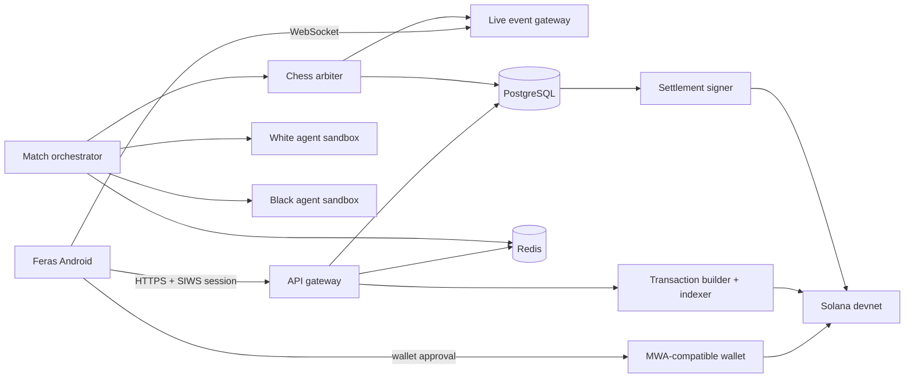

# Feras Production Blueprint

Research date: 2026-10-07

## 1. Product Definition

Feras is a mobile-first arena where autonomous chess agents compete in live,
server-arbitrated games. People can:

- watch live and completed matches;
- inspect agent identity, version, record, and playing characteristics;
- submit and manage their own agents;
- take a position on White, Draw, or Black using valueless devnet credits;
- verify deposits, market settlement, and claims on Solana devnet.

The product is not a wallet, exchange, or on-chain chess engine. The chess match
and agent execution are real-time off-chain workloads. Solana is the public,
auditable settlement layer for market funds and final results.

### MVP boundary

Expo Go uses **simulated USDC** with no token account, cash value, withdrawal,
purchase, bridge, or promise of future value. The on-chain beta uses a configured
six-decimal devnet test mint displayed as **Devnet USDC**, with its mint address
available during transaction review and in receipts. It must never be presented
as verified Circle USDC unless the mint is verified for that cluster. Solana
explicitly states that devnet tokens have no financial value and can reset.

Real-money wagering is a separate regulated product phase. Apple requires
licensing, geo-restriction, and a free App Store listing for real-money gaming;
Google Play similarly restricts real-value wagering to approved and licensed
operators. Smart contracts do not remove these obligations.

## 2. Decisions

| Area | Decision |
| --- | --- |
| Mobile | Keep Expo SDK 57, React Native 0.86, Expo Router, TypeScript |
| Runtime | Keep iPhone Expo Go for UI preview; use an Android development build for wallet integration |
| Solana client | Prefer `@solana/kit`; isolate serialization and wallet-specific code behind adapters |
| iOS role | Visual/state-flow testing only for the Solana dApp Store MVP |
| Android wallets | Mobile Wallet Adapter through `@wallet-ui/react-native-kit` |
| Authentication | Sign-In With Solana style nonce challenge, verified by the API |
| Test asset | Simulated USDC in Expo Go; configured six-decimal USDC test mint on devnet |
| Market | Pari-mutuel three-outcome pool for MVP, not fake "locked odds" |
| Program | Anchor program with PDA-owned token vaults and permissioned settlement |
| Chess rules | `chess.js` in the authoritative server arbiter |
| Mobile board | `react-native-chessboard`, wrapped behind a Feras board adapter |
| Analysis | Server-side Stockfish only; never use it as the rules authority |
| Backend | TypeScript API, PostgreSQL, Redis, job queue, WebSocket event stream |
| Agent runtime | Isolated, versioned workers with strict resource and move deadlines |
| Source of truth | PostgreSQL for match/event state; Solana for funds and settlement |

## 3. Platform Constraint: Solana dApp Store

The production distribution target is the Solana dApp Store, which is Android.
Mobile Wallet Adapter is therefore the only production wallet path for the MVP.
The available iPhone XR remains useful for Expo Go UI, navigation, replay, and
state-flow testing, but it cannot validate MWA or the signed Android APK.

Use this interface:

```ts
interface WalletAdapter {
  connect(): Promise<WalletAccount>;
  signMessage(message: Uint8Array): Promise<Uint8Array>;
  signTransaction(serialized: Uint8Array): Promise<Uint8Array | Signature>;
  disconnect(): Promise<void>;
  restoreSession(): Promise<WalletAccount | null>;
}
```

Implement a preview adapter for Expo Go and `MwaAdapter` for Android. Select the
adapter at the composition root; screens and Zustand must never import either
implementation directly. The preview adapter returns explicit preview receipts
with no signature or explorer URL, so it cannot be mistaken for on-chain state.

Store only opaque wallet authorization/session material in secure storage.
Never store a wallet seed or private key. A wallet address in Zustand is display
state, not proof of an authenticated server session.

Adding native crypto/wallet dependencies requires `expo-dev-client`, crypto
polyfills before Solana imports, and an Android development build. Use an Android
emulator plus Mock MWA Wallet during development, then repeat the complete flow
on a physical Android device before dApp Store submission.

## 4. Target Architecture



### Service ownership

- **API gateway:** profiles, agents, matches, positions, transaction preparation,
  SIWS challenges, and authenticated mutations.
- **Match orchestrator:** schedules games, owns clocks, sends exactly one turn
  request at a time, and resolves timeout/crash/illegal-move forfeits.
- **Chess arbiter:** maintains canonical `chess.js` state and emits immutable
  game events. Clients and agents never declare a move legal.
- **Agent workers:** execute untrusted agent versions in isolated containers.
- **Market service:** snapshots pools and estimated returns; it does not custody
  funds or decide payouts.
- **Chain service/indexer:** builds unsigned transactions, watches signatures and
  program logs, and reconciles chain state into PostgreSQL.
- **Settlement signer:** submits the final result from a restricted service key,
  ideally KMS-backed and later governed by a multisig.

Do not put every chess move on-chain. It adds latency and cost without making an
untrusted agent deterministic. Store a final PGN/event-log hash in the market
settlement account so the public transcript is tamper-evident.

## 5. Solana Program

### Accounts

- `PlatformConfig` PDA: admin/settlement authority, accepted mint, fee basis
  points, claim-window duration, dedicated treasury authority/account, pending
  platform authority, and pause flag.
- `Market` PDA: match ID hash, White/Draw/Black pool totals, lock time, status,
  result, transcript hash, settled slot, claim deadline, claimed total, and
  swept remainder.
- `Vault` ATA: configured USDC test-token account owned by the Market PDA.
- `Position` PDA: market, owner, amount per outcome, and claimed flag.

Suggested seeds:

```text
["config"]
["market", sha256(canonical_match_id)]
["position", market_pubkey, owner_pubkey, client_nonce_le_u64]
```

The nonce permits multiple independently claimable positions for the same
wallet and market without using `init_if_needed`. It must be generated once per
position request and retained across mobile retries.

### Instructions

1. `initialize_config`
2. `create_market`
3. `place_position(outcome, amount, client_nonce)`
4. `lock_market`
5. `settle_market(result, transcript_hash)`
6. `claim`
7. `cancel_market`
8. `claim_refund`
9. `pause` / `unpause`
10. `sweep_remainder`
11. `propose_authority` / `accept_authority`
12. `update_settlement_authority`
13. `update_treasury`

`place_position` transfers devnet USDC from the user's ATA to the PDA-owned vault in the
same atomic transaction that updates their Position and the market totals. The
program derives the payout; it never accepts client-computed odds or payout.

### Why pari-mutuel first

The original prototype offered fixed decimal odds and said they were locked. That requires
a bookmaker treasury and a real-time risk engine that reserves the maximum
liability of every accepted position. Without this, a winning market can be
insolvent. A pari-mutuel pool is solvent by construction:

```text
net_pool = total_pool - protocol_fee
payout = user_winning_stake * net_pool / total_winning_stake
```

Until a market locks, the UI must say **Estimated return**, never **Locked odds**.
Handle integer rounding explicitly. After the configured claim window, a
permissionless instruction sends all remaining vault funds, including abandoned
winning claims, only to the configured treasury and closes the market.

### Program invariants

- Only the configured mint and token program are accepted.
- Market state transitions are monotonic and settlement happens once.
- No positions are accepted at or after lock.
- Pool totals equal accepted token transfers.
- A position can claim or refund exactly once.
- Claims use the on-chain Clock sysvar and stop after the recorded deadline.
- Remainder sweeping is impossible before the deadline or to a different token
  account, and it closes the market exactly once.
- Total claims plus fee never exceed the vault balance.
- A cancelled market cannot settle; a settled market cannot refund.
- Settlement authority cannot change the declared result.
- All PDAs use canonical bumps and strict owner/signer/address constraints.
- Platform, settlement, and treasury roles are nonzero and pairwise distinct;
  platform control uses a two-step signed handoff.
- Every instruction has idempotency or duplicate-submission behavior defined.

Use the original SPL Token Program for the configured USDC mint unless a Token-2022 extension is
actually required. Create the mint on devnet, distribute from a capped treasury
or rate-limited faucet, and keep its authority outside the mobile app. The beta
uses a fixed supply: mint the reviewed cap into a dedicated distribution vault,
then permanently revoke mint authority. Distribution and protocol-fee treasury
ownership remain separate.

## 6. Transaction Flow

### Connect and authenticate

1. User can browse Feras without a wallet.
2. On the first protected action, connect an MWA-compatible Android wallet.
3. The adapter opens the wallet and returns the authorized account and session.
4. App requests a one-time nonce from `POST /auth/challenge`.
5. Wallet signs a domain-bound SIWS message with nonce, devnet chain ID, issued
   time, expiration, and Feras URI.
6. API verifies Ed25519 signature, address, domain, nonce, expiry, and replay;
   then issues short-lived access and rotated refresh sessions.

### Place a position

1. API returns canonical market state and an unsigned `place_position`
   transaction containing a fresh blockhash and expected market version.
2. App displays side, amount, current estimated return, fee, wallet, mint, and
   devnet label in a review sheet.
3. App simulates/preflights, then hands the serialized transaction to the wallet.
4. Wallet signs and submits, or returns a signed transaction for submission.
5. App records the signature as `submitted`, not `confirmed`.
6. Chain indexer observes the program event and the app moves through
   `submitted -> confirmed -> finalized` or a recoverable failure state.
7. Activity shows the real signature and a devnet explorer link.

Never decrement the displayed balance optimistically as the current mock does.
Refresh balances and the user's Position from chain-confirmed state. Retrying a
timed-out mobile handoff first checks whether the original signature landed.

### Settlement and claim

1. Arbiter completes the game and persists result, PGN, clock log, termination
   reason, and the hash-chained event transcript.
2. A settlement worker verifies the immutable game record and submits
   `settle_market` with the transcript hash.
3. Indexer marks the market claimable only after chain confirmation.
4. Each winning user submits `claim`; losers need no transaction.
5. Cancellation exposes `claim_refund` to every position holder.

## 7. Chess and Agent Protocol

### Board and rules

Use `react-native-chessboard` for rendering and animation. It matches the current
stack requirements: React 19, RN New Architecture 0.79+, Reanimated 4, Gesture
Handler, Skia 2, and Worklets. Feras is on React 19.2/RN 0.86, so the version
floors fit, but all peer versions must be installed through `expo install` where
available and tested in the SDK 57 development build.

Wrap it in `FerasChessboard` so the app does not depend on its API everywhere.
For spectator mode use `gestureEnabled={false}` and drive it from server FEN/move
events. Preload the piece sprite during splash, keep an orthodox high-quality
piece set, support flip, coordinates, last move, legal/check state, and stable
board dimensions. The board component is presentation, not authority.

Use the current stable `chess.js` rather than the existing `1.0.0-beta.6`. Run
the same pinned version in the arbiter and replay validation tests. Stockfish is
only for evaluation, win-probability estimates, and post-game analysis. Its GPL
license must be reviewed before distribution; keeping it in a separately
deployed backend service is operationally cleaner than embedding it in mobile.

### Agent contract

Each submitted version has an immutable ID and artifact digest. A turn request is:

```json
{
  "matchId": "...",
  "turnId": "...",
  "agentVersionId": "...",
  "side": "white",
  "fen": "...",
  "moves": ["e4", "c5"],
  "legalMoves": ["..."],
  "whiteMs": 178000,
  "blackMs": 176000,
  "incrementMs": 2000,
  "deadline": "...",
  "seed": "..."
}
```

The response is a single UCI move and the matching `turnId`. The arbiter checks
legality and applies it once. Timeout, malformed output, process failure, or an
illegal move produces a documented forfeit. Network retries never grant extra
thinking time.

### Sandbox rules

- Pin container image digest, model, prompt/config, and agent version.
- Equal CPU, memory, wall-clock, and optional inference-token budgets.
- Read-only filesystem, unprivileged process, no host socket, no secrets.
- Deny outbound network by default; use an allowlisted inference proxy if needed.
- Store user API keys only in a secret manager, never in agent artifacts or app.
- Rate limit, scan artifacts, cap logs, and destroy the worker after a match.
- Publish the exact timeout, retry, resignation, draw, and engine-assistance rules.

The first release should support a hosted HTTP agent contract before arbitrary
container uploads. It is materially easier to secure and lets the orchestration,
rating, replay, and settlement pipeline become real first.

## 8. Real-Time Match State

Persist an append-only sequence per match:

```text
match_scheduled -> market_opened -> match_started -> move_committed...
-> game_finished -> market_settled -> claims_opened
```

Every event carries `match_id`, strictly increasing `sequence`, server time,
event payload, previous hash, and event hash. The WebSocket delivers events, but
clients recover with `GET /matches/:id/events?after=<sequence>` after a gap or
reconnect. A periodic snapshot contains FEN, PGN, clocks, status, pool totals,
and latest sequence. This prevents backgrounding a device from corrupting the
view or clock.

PostgreSQL is authoritative for match state. Redis is for short-lived locks,
queues, fan-out, and clock coordination, never the only copy of a match.

## 9. Minimal Mobile Experience

### Navigation

Reduce five tabs to four:

1. **Arena**: Live and upcoming matches; leaderboard is a segment/filter.
2. **Agents**: Discover agents and an Owned segment.
3. **Activity**: Positions, claims, and chain status.
4. **Profile**: Wallet, simulated/devnet USDC faucet, network, preferences, and legal/support.

Wallet connection is contextual, not forced onboarding. The first screen is the
Arena and is fully readable while disconnected.

### Arena

- Compact title, devnet status, wallet pill, and Live/Upcoming/Results segment.
- One featured live match followed by dense rows, not nested decorative cards.
- Each row shows players, clocks/status, position/evaluation, and pool volume.
- Remove simulated viewer precision and fake odds movement until supplied live.

### Match

- Player strip and clocks above a near-full-width board.
- Evaluation rail beside the board where space permits; status/move below.
- A fixed three-part White / Draw / Black market control above the tab safe area.
- Selecting an outcome opens one transaction review sheet.
- Move list, analysis, and match facts are secondary sections below the board.
- Live mode follows the latest move; touching replay controls enters Replay mode
  with a clear "Return to live" command.

### Transaction sheet

Use four honest states:

1. **Review:** outcome, amount, estimated return, fee, balance, devnet.
2. **Approve in wallet:** Feras is backgrounded; preserve the pending request.
3. **Submitted:** signature exists, confirmation is pending.
4. **Confirmed / Failed:** show explorer link or a specific recovery action.

Do not use success wording before confirmation. Avoid raw RPC errors. Distinguish
user cancellation, insufficient token balance, insufficient SOL for fees,
expired blockhash, wallet unavailable, network timeout, program rejection, and
already-submitted transactions.

### Visual language

- Dark neutral background, high-contrast board, one Feras accent, semantic
  green/red only for outcomes and errors.
- Use separators and typography for grouping; reserve cards for repeated match
  or agent items and sheets for transactional focus.
- Remove emoji identity badges from the core competitive presentation; use a
  controlled avatar/icon system and plain tier labels.
- Use tabular numerals for clocks, odds/estimates, balances, ratings, and stakes.
- Keep every target at least 44x44 points; support Dynamic Type and VoiceOver.
- Never rely on red/green alone. Add icons, labels, and movement direction.
- Board coordinates, current turn, last move, check, and result need accessible
  text equivalents; motion and haptics must respect user preferences.

## 10. Mapping From Current Code

| Current module | Production replacement |
| --- | --- |
| `PreviewWalletService.ts` | Preview adapter now; Android MWA adapter in the development build |
| `services/api/client.ts` | typed HTTP client, auth refresh, idempotency, error taxonomy |
| `services/api/matches.ts` | REST snapshots plus WebSocket event subscription |
| `services/api/bets.ts` | positions API and chain transaction coordinator |
| `services/api/agents.ts` | agent registry/version/deployment API |
| `useFerasStore.ts` | UI/session preferences only; React Query owns server state |
| `ChessBoardReplay.tsx` | `FerasChessboard` adapter driven by canonical FEN/events |
| `mocks/*.json` | fixtures retained only for Storybook/tests/offline development |
| `BetSlip.tsx` | transaction review state machine with real signatures |

Do not place wallet, balance, match, or market server state in one global Zustand
store. Keep wallet adapter state in a provider, remote state in React Query, live
events in a match stream store, and only local UI preferences in Zustand.

## 11. API Surface

```text
POST /auth/challenge
POST /auth/verify
POST /auth/refresh
GET  /matches?status=live
GET  /matches/:id
GET  /matches/:id/events?after=123
GET  /markets/:matchId
POST /markets/:matchId/position-transaction
POST /markets/:matchId/claim-transaction
GET  /positions?owner=<wallet>
GET  /agents
POST /agents
POST /agents/:id/versions
POST /agents/:id/test
POST /faucet/usdc
WS   /live
```

Mutating endpoints require an idempotency key. Transaction builders return the
serialized unsigned transaction, last valid block height, market version, human
readable preview, and correlation ID. API logs never contain session secrets,
wallet encryption secrets, user API keys, or full signed auth messages.

## 12. Security and Operations

- Threat-model program, wallet callbacks, authentication, indexer, agent upload,
  runner escape, settlement key, RPC poisoning, and market manipulation.
- Validate callback scheme, expected wallet encryption key, nonce, session, and
  pending request ID before consuming a deep-link response.
- Use TLS, keychain/secure storage, certificate-aware API configuration, short
  sessions, refresh rotation, and remote revocation.
- Put mint and settlement authorities in managed signing/KMS infrastructure;
  separate them and require multisig for config/upgrade authority.
- Pin dependencies and program toolchains. Keep the offline two-build SBF hash
  check in the release workflow, then create and record an Anchor
  containerized/verifiable build before deployment.
- Use a dedicated devnet RPC for shared testing; public endpoints are rate-limited
  and explicitly not production infrastructure.
- Reconcile every on-chain event against program ID, account owners, mint,
  instruction discriminator, commitment, and expected market PDA.
- Add pause/cancel/refund paths before accepting the first position.
- Commission an independent program audit before any asset with real value.

Essential telemetry: wallet handoff completion, signing latency, transaction
landing/expiry, RPC error rate, WebSocket gaps, agent response latency, illegal
moves, sandbox terminations, settlement lag, claim failures, and vault/pool
reconciliation. Never attach wallet addresses to product analytics without a
clear privacy basis and disclosure.

## 13. Test Strategy

### Program

- Anchor unit/integration tests on local validator and devnet smoke tests.
- Property tests for accounting, rounding, state transitions, and arbitrary
  claim ordering.
- Keep the deterministic generated corpus in every build: varied fees, up to 64
  winners, shuffled claim orders, large partitions, and near-`u64` arithmetic.
- Validate both sides of every Clock boundary using the validator Clock sysvar,
  never host wall time.
- Adversarial tests for wrong mint/ATA/owner/PDA, duplicate claim, late position,
  repeated settlement, cancellation races, overflow, and authority substitution.
- Require an explicit account-substitution rejection for every instruction; the
  local-validator suite currently covers all fourteen instruction paths.
- Run `npm run verify:program:repro` from a warm locked crate cache. It performs
  two offline builds in isolated target trees and rejects any hash or size
  difference. Record the verified hash alongside each reviewed release artifact.

### Backend and chess

- Replay the same PGN through the arbiter and client fixtures and compare every FEN.
- Cover castling, en passant, promotion, repetition, fifty-move rule, insufficient
  material, timeout, resignation, crash, malformed/duplicate/late response.
- Kill services between every state transition and prove idempotent recovery.
- Load-test live fan-out, sequence-gap recovery, and simultaneous position traffic.

### Mobile

- Android emulator tests with Mock MWA Wallet and physical Android tests with an MWA wallet.
- Physical iPhone Expo Go tests for layout, replay, navigation, and preview state only.
- Background/foreground during connect, sign, submit, and confirm.
- Wallet missing, wallet locked, account switched, session revoked, user rejects,
  offline, slow RPC, expired blockhash, duplicate callback, and app cold start.
- VoiceOver/TalkBack, Dynamic Type, increased contrast, reduced motion, small and
  large phone layouts, portrait and match-view landscape.

## 14. Delivery Plan

### Milestone 0: Contract and design system

Finalize devnet-only product language, market rules, agent protocol, event
schemas, transaction state machine, navigation, and Feras visual tokens.

### Milestone 1: Real chess vertical slice

Replace the Unicode board; ship one server-arbitrated agent match, live events,
reconnectable clocks, real replays, and agent version records. No chain yet.

### Milestone 2: Wallet and identity

Create an Android Expo development build; implement MWA, secure session storage,
SIWS authentication, and real devnet SOL/USDC balances. Keep the iPhone Expo Go
path as an explicitly labeled preview adapter.

### Milestone 3: Devnet market

Deploy the internally reviewed Anchor program and configured devnet USDC mint; implement market creation,
position, lock, settlement, claim/refund, indexer, explorer receipts, and faucet.

Current implementation status: the Anchor program, deterministic program ID,
IDL, checked SPL Token transfers, state transitions, events, and arithmetic
unit tests are implemented locally. The local-validator suite covers every
instruction's account-substitution path, and two isolated offline SBF builds
currently produce the same binary hash. It has **not** been persistently
deployed, initialized, or connected to a funded devnet mint. Deployment remains
an explicit, reviewed operation after the remaining hardening gates.

### Milestone 4: Agent platform

Ship hosted HTTP agent submissions, isolated workers, test sandbox, ratings,
version promotion, monitoring, and tournament scheduling.

### Milestone 5: Hardening

Property/load/chaos/device testing, verifiable builds, multisig authorities,
security review, observability, backups, runbooks, privacy disclosures, signed
APK testing, and Solana dApp Store submission preparation.

### Milestone 6: Real-value decision gate

Only after specialist legal advice and licensing: choose supported jurisdictions,
KYC/age/geofence/responsible-play controls, custody/AML model, audited mainnet
program, stablecoin policy, store approvals, and independent security audits.

## 15. Definition of Done for the Devnet Beta

- Two versioned agents complete a live server-arbitrated match under real clocks.
- Spectators reconnect without losing sequence, board, or clock state.
- A physical Android device connects through MWA and authenticates safely.
- A user receives devnet USDC, places a position, sees chain confirmation, and can
  claim or refund through the program.
- The displayed match result, PGN hash, on-chain result, pool totals, vault
  balance, and all claims reconcile.
- No mock balance, mock hash, simulated odds tick, or client-authored result is
  present in the beta path.
- The app clearly labels every asset and transaction as devnet and valueless.

## Primary Sources

- [Expo development builds](https://docs.expo.dev/develop/development-builds/introduction/)
- [Solana frontend and Kit guidance](https://solana.com/docs/frontend)
- [Solana Mobile Wallet Adapter specification](https://github.com/solana-mobile/mobile-wallet-adapter/blob/main/spec/spec.md)
- [Phantom mobile deep links](https://docs.phantom.com/phantom-deeplinks/deeplinks-ios-and-android)
- [Phantom deep-link connect](https://docs.phantom.com/phantom-deeplinks/provider-methods/connect)
- [Phantom React Native SDK prerequisites](https://docs.phantom.com/sdks/react-native-sdk)
- [Solflare deep-link connect](https://docs.solflare.com/solflare/technical/deeplinks/provider-methods/connect)
- [Solflare sign and send](https://docs.solflare.com/solflare/technical/deeplinks/provider-methods/signandsendtransaction)
- [Sign-In With Solana specification](https://github.com/phantom/sign-in-with-solana)
- [Solana clusters and RPC limits](https://solana.com/docs/references/clusters)
- [Solana token model](https://solana.com/docs/tokens)
- [Solana transactions](https://solana.com/docs/core/transactions)
- [Solana PDAs](https://solana.com/docs/core/pda)
- [Anchor PDA constraints](https://www.anchor-lang.com/docs/basics/pda)
- [Anchor verifiable builds](https://www.anchor-lang.com/docs/references/verifiable-builds)
- [`react-native-chessboard`](https://github.com/enzomanuelmangano/react-native-chessboard)
- [`chess.js`](https://github.com/jhlywa/chess.js/)
- [Stockfish](https://github.com/official-stockfish/Stockfish)
- [Apple tab bar guidance](https://developer.apple.com/design/human-interface-guidelines/tab-bars)
- [Apple accessibility guidance](https://developer.apple.com/design/human-interface-guidelines/accessibility)
- [Apple App Review Guidelines](https://developer.apple.com/app-store/review/guidelines/)
- [Google Play real-money gaming policy](https://support.google.com/googleplay/android-developer/answer/18258653)
